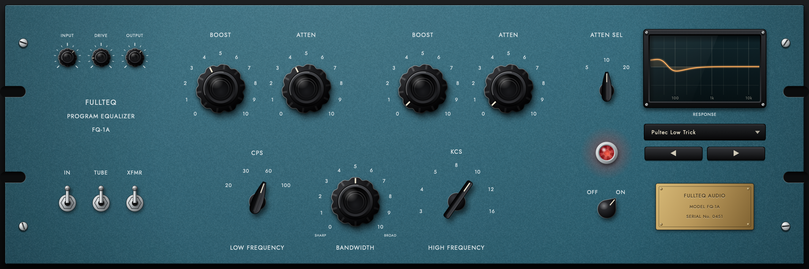

# Fullteq 0.9.0 Beta

Fullteq is a passive tube program equalizer for macOS. It models a five-stage
passive EQ network, a triode-style saturation stage, and a transformer core
with hysteresis and high-frequency iron loss.



## Formats and requirements

- macOS 11 or later, Universal 2 (`arm64` and `x86_64`)
- VST3, AU, and Standalone
- 44.1, 48, 88.2, 96, 176.4, and 192 kHz hosts

## Install

1. Download `Fullteq-0.9.0-macOS-universal.zip` from GitHub Releases.
2. Verify the download against `SHA256SUMS.txt`.
3. Run `Install Fullteq.command`.

The installer copies the plug-ins into the current user's Audio Plug-Ins
folders and the Standalone app into `~/Applications`. It does not use `sudo`.

This beta is ad-hoc signed and not notarized. macOS Gatekeeper can block the
Standalone app. Right-click the app and choose Open. If a host refuses to load
a plug-in, read `INSTALL.txt` and remove the quarantine attribute for the
installed bundle. That command lowers macOS protection for that bundle only.

## Controls

| Control | Function |
| --- | --- |
| CPS | Low-frequency dial: 20, 30, 60, or 100 Hz |
| LOW BOOST | Wide low shelf with a fixed 700 Hz corner |
| LOW ATTEN | Low cut shelf whose corner follows CPS |
| KCS | High-frequency dial: 3 to 16 kHz |
| HIGH BOOST | Resonant high peak with BANDWIDTH control |
| BANDWIDTH | SHARP (0) to BROAD (10) |
| ATTEN SEL | High-cut shelf at 5, 10, or 20 kHz |
| HIGH ATTEN | High shelf cut at the ATTEN SEL frequency |
| INPUT / OUTPUT | Input and output trim |
| DRIVE | Tube and transformer saturation |
| IN | Switches the passive EQ network only |
| TUBE / XFMR | Switches the tube and transformer stages |
| POWER | Bypasses the complete processor |

`IN` off keeps the tube and transformer available as a color stage. `POWER`
off compares against the latency-aligned dry path.

## Build and test

```sh
cmake -B build -DCMAKE_BUILD_TYPE=Release -DFULLTEQ_INSTALL_PLUGINS=OFF
cmake --build build --target FullteqTests --parallel 4
./build/FullteqTests_artefacts/Release/FullteqTests
cmake --build build --target Fullteq_VST3 Fullteq_AU Fullteq_Standalone --parallel 4
```

To install while building, omit `-DFULLTEQ_INSTALL_PLUGINS=OFF`.

## Validation

This beta passes the offline DSP test suite, `pluginval` strictness 10 on
VST3, and `auval` on AU. Ableton Live 12.4.6 is the only tested host. See
`LIVE-VALIDATION.md` for the results. Verify downloaded files with
`SHA256SUMS.txt`.

## License

Fullteq is free software under the GNU Affero General Public License v3.0.
See `LICENSE`. The complete source is available at
<https://github.com/eefsowa-source/Fullteq>.

JUCE 8.0.6 is used under AGPLv3. The embedded Jost typeface is used under the
SIL Open Font License 1.1. See `THIRD_PARTY_NOTICES.md` and
`Source/Fonts/OFL.txt`.

## Known limitations

- This beta is not signed with an Apple Developer ID and is not notarized.
- macOS 11 is the declared minimum. Current testing is on a newer macOS.
- Ableton Live is the only tested host.
- Windows, AAX, and copy protection are not included.
